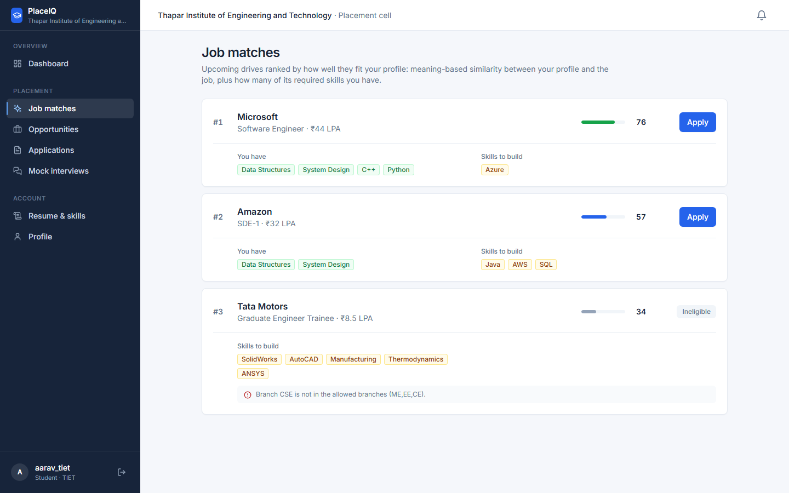
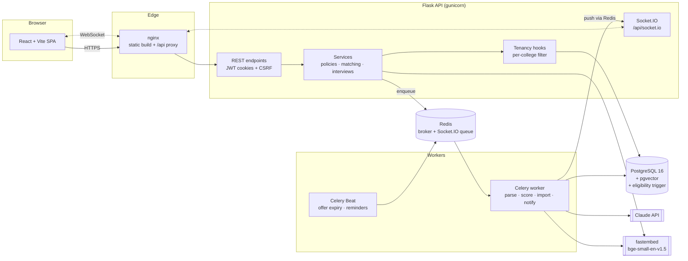

# PlaceIQ — AI-powered campus placement platform

[](https://github.com/svm-codes-fs/Placement-management-system/actions/workflows/ci.yml)


PlaceIQ runs campus recruitment for many colleges on one deployment. Students
upload a resume and get drives ranked by fit, see exactly why they can't apply
somewhere, practise AI mock interviews and follow every application live.
Placement cells run the pipeline, set placement rules, import students in bulk
and get ranked candidates for each drive.



**Demo video:** [docs/demo.webm](docs/demo.webm) (a full walkthrough: student, college admin, super admin).
**More screenshots:** [docs/screenshots/](docs/screenshots/).

## Highlights

- **Multi-tenant by design.** Every college's data is isolated by SQLAlchemy session hooks that add the college filter to every query and refuse cross-college writes; a PostgreSQL trigger enforces the same rules if the API is bypassed.
- **AI resume parsing.** Claude reads the PDF and returns structured skills, projects and experience (validated structured outputs); students review the result before it's used. Without an API key an offline parser takes over.
- **Semantic job matching.** Local embeddings (`bge-small-en-v1.5`, no API cost) in pgvector, combined with required-skill coverage and eligibility. **Precision@5 of 0.95** on a labelled set (random: 0.125).
- **AI mock interviews.** Questions written for the drive and the student's own profile; answers scored on correctness, clarity and depth with specific feedback, plus a progress chart.
- **Placement policy engine.** Rules are data, not code (offer limits, dream-tier lock, CGPA floor, one job per student), and "Why can't I apply?" lists every failed rule.
- **Real-time and background work.** Celery + Redis for resume parsing, scoring, bulk imports, emails and scheduled offer expiry; Socket.IO pushes notifications to the right user live, even from worker processes.
- **Measured, not assumed.** Composite indexes made the busiest admin query 38× faster, pagination took an endpoint from 1,081 ms to 26 ms, and an HNSW index was dropped after measuring recall 0.26 under the tenant filter. See [BENCHMARKS.md](BENCHMARKS.md).

## Architecture



A request carries a JWT (httpOnly cookie) naming the user's role and college.
The tenancy hooks scope every query to that college. Slow work (reading a
resume, scoring an interview, importing 5,000 students) is queued in Redis and
done by a Celery worker, which pushes the result back to the user's browser
through Socket.IO's Redis message queue.

## Features by role

| Student | College admin (placement cell) | Super admin |
|---|---|---|
| Register into a college; profile with read-only CGPA/backlogs | Dashboard with a live recruitment funnel | Add colleges with their first admin |
| Upload a resume; review AI-extracted skills | Students: add, edit, delete, CSV import with per-row errors | Platform-wide stats per college |
| Job matches ranked by fit, with skills to build | Drives with eligibility rules and required skills | |
| Every drive with the exact reasons it's closed to you | Top candidates per drive (AI ranking) and eligibility lists | |
| Apply; timeline of every status change; accept or decline offers | Pipeline: shortlist → interview → offer, with audit timeline | |
| AI mock interviews with scored feedback and progress | Placement policies per college | |
| Live notifications and email | Results with CSV export; branch-wise reports | |

## Tech stack

| Layer | Tools |
|---|---|
| Frontend | React 18, Vite, Tailwind CSS, Framer Motion, socket.io-client |
| API | Flask 3, SQLAlchemy 2, Flask-JWT-Extended, Flask-SocketIO, Alembic |
| Data | PostgreSQL 16, pgvector, PL/pgSQL trigger; SQLite for quick local runs |
| AI | Claude API (structured outputs, refusal fallback), fastembed (ONNX, CPU) |
| Async | Celery 5 + Redis, Celery Beat |
| Quality | pytest (58 tests, 89% coverage, run on SQLite and PostgreSQL), ruff, Locust |
| Delivery | Docker, docker compose, nginx, gunicorn, GitHub Actions |

## Getting started

### With Docker

```bash
docker compose up --build
```

Starts PostgreSQL, Redis, the API, the Celery worker and scheduler, and the
frontend, with migrations and demo data applied. Open http://localhost:3000.

### Without Docker

Requires Python 3.12 and Node 20. Uses SQLite and runs background jobs inline.

```bash
pip install -r requirements-dev.txt
```

```bash
flask --app run.py db upgrade
```

```bash
flask --app run.py seed
```

```bash
python run.py
```

In a second terminal:

```bash
npm --prefix frontend install
```

```bash
npm --prefix frontend run dev
```

Open http://localhost:3000. Configuration lives in `.env` (see [`.env.example`](.env.example)). Add
`ANTHROPIC_API_KEY` to turn on Claude for resume parsing and interviews; without
it the offline parser and scoring rubric are used and labelled in the UI.

### Demo accounts

`flask seed` creates two colleges. Every account uses the `SEED_PASSWORD`
(default `password123`; change it anywhere but your own machine).

| Role | Username | Try |
|---|---|---|
| Super admin | `superadmin` | Add a college |
| College admin | `tiet_admin` | Top candidates for Texas Instruments, Policies, CSV import |
| College admin | `dit_admin` | A second college: none of TIET's data is visible |
| Student | `aarav_tiet` | Job matches, upload `samples/resumes/backend_developer.pdf`, a mock interview |
| Student | `ananya_tiet` | Accept the pending offer and watch the admin's bell |
| Student | `rohan_tiet` | Opportunities: every reason a drive is closed |

## Testing

```bash
pytest --cov=app
```

Set `TEST_DATABASE_URL` to a PostgreSQL database to run the suite there (CI does),
which also exercises the eligibility trigger. CI runs lint, migrations up and
down, the tests on PostgreSQL with pgvector, the frontend build, and the full
production stack in Docker with an end-to-end smoke test through nginx.

## Documentation

- [BENCHMARKS.md](BENCHMARKS.md): query plans, endpoint latency, load test, matching quality
- [DEPLOY.md](DEPLOY.md): one-VM deployment with Docker, or managed services
- [docs/RESUME.md](docs/RESUME.md): how to describe this project on a resume
- [PROJECT_REPORT.md](PROJECT_REPORT.md): the original DBMS course report (UCS310, Thapar)

## Project structure

```
├── app/
│   ├── api/            REST endpoints: auth, student, admin, super admin, interviews, notifications
│   ├── services/       Business logic: policies, applications, matching, embeddings, resumes, interviews, ai
│   ├── models/         SQLAlchemy models (one module per entity)
│   ├── tasks/          Celery tasks and the worker entry point
│   ├── tenancy.py      Per-college isolation for every query
│   ├── security.py     JWT authentication and role checks
│   ├── realtime.py     Socket.IO live notifications
│   ├── db_rules.py     PostgreSQL eligibility trigger
│   └── bulk_seed.py    `flask seed-large` benchmark data
├── migrations/         Alembic migrations
├── frontend/           React app (Dockerfile.prod + nginx.conf for production)
├── tests/              pytest suite
├── benchmarks/         DB, API, load and matching benchmarks with raw results
├── scripts/            Sample resume generator, smoke test, screenshot/video capture
├── samples/resumes/    Sample PDFs for trying resume parsing
├── docker-compose.yml          Development stack
└── docker-compose.prod.yml     Production stack (nginx, gunicorn, Celery, PostgreSQL, Redis)
```

Built on top of a UCS310 Database Management Systems course project at Thapar
Institute of Engineering and Technology; the original stored procedures and
triggers are kept in [`sql/`](sql/).
